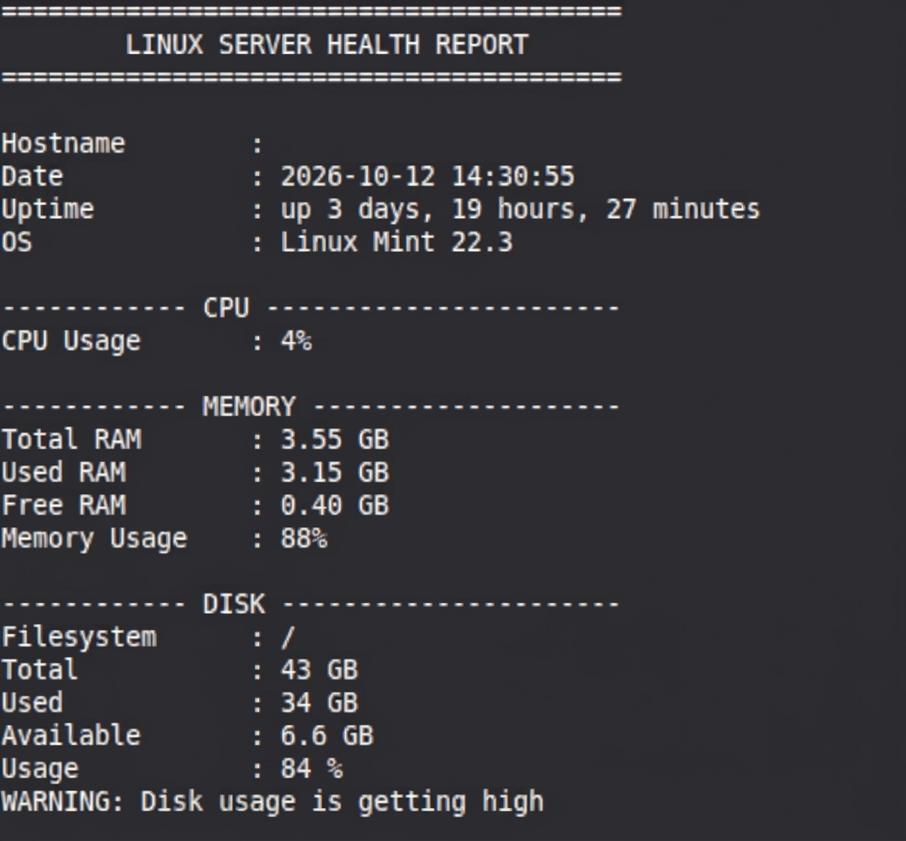

# Linux Health Monitor

A Bash-based system monitoring tool for **Ubuntu Linux and Ubuntu on WSL**. It displays essential system information, monitors resource usage, detects high resource consumption, and reports the overall system health.

## Features

* **System Information** — Hostname, operating system, date, and uptime.
* **CPU Monitoring** — Measures CPU utilization.
* **Memory Monitoring** — Displays RAM usage and detects high memory consumption.
* **Disk Monitoring** — Checks disk space usage and warns when usage is high.
* **Process Monitoring** — Lists resource-intensive processes.
* **User Monitoring** — Displays currently logged-in users.
* **Service Monitoring** — Reports relevant system services.
* **Network Information** — Displays available network information, including IP addresses.
* **Health Status** — Summarizes system health and reports alerts when thresholds are reached.

## Requirements

* Ubuntu Linux or Ubuntu on WSL
* Bash
* Standard Linux command-line utilities

## Installation and Usage

Clone the repository:

```bash
git clone https://github.com/Mosaleh36/Linux-Health-Monitor.git
```

Navigate to the project directory:

```bash
cd Linux-Health-Monitor
```

Run the script:

```bash
bash healthcheck.sh
```

## Alert Thresholds

| Resource Usage | Status |
|----------------|--------|
| Below 75% | Healthy |
| 75% to below 90% | Warning |
| 90% or above | Critical |

These thresholds are used to identify elevated resource usage. Overall health status also depends on whether the required metrics can be collected successfully.

## Example Output



*Example output from the Linux Health Monitor script.*

## Project Structure

```text
Linux-Health-Monitor/
├── healthcheck.sh
├── README.md
└── Linux-health-screenshot.jpeg
```

## Limitations

* The script relies on Linux system files and command-line utilities.
* Some service information may vary between Ubuntu installations and WSL environments.
* Resource measurements represent a snapshot of system activity and may change over time.

## Future Improvements

* Add configurable alert thresholds.
* Improve error handling and metric validation.
* Add logging and historical reports.
* Extend monitoring with additional system metrics.

## Purpose

This project was built to practice Bash scripting, Linux system administration, process monitoring, and troubleshooting while developing practical DevOps skills.
